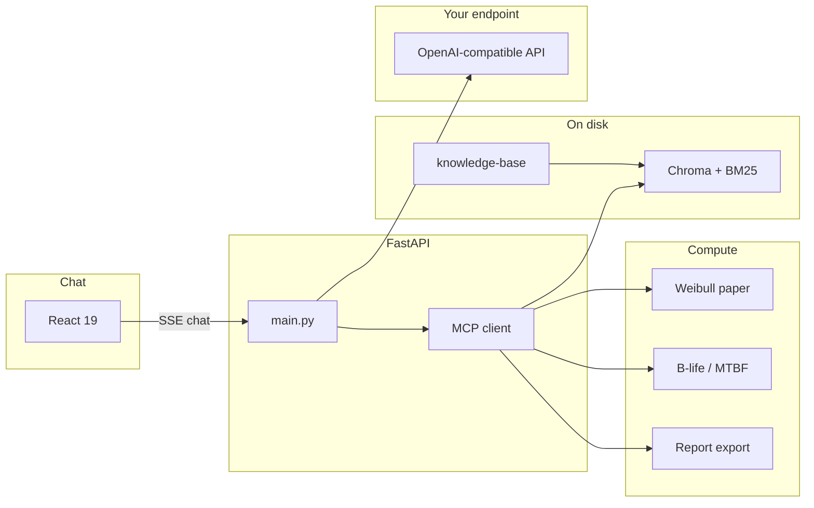

# Reliability Copilot

**Natural language in. Defensible Weibull paper and B-life out. Company documents stay on disk. The language model never invents β, η, or a warranty call.**

A **private reliability engineering agent**: life data and procedures on your machine (or VPC), an OpenAI-compatible LLM you choose, and **MCP tools** that compute every life metric. The model plans and explains. Python produces the plot and the numbers.

```
failures + suspensions  →  probability paper (ranks, η @ 63.2%, β)
warranty / mission life →  B10 / B20 / B30 vs the commitment (tools, not chat)
PDF / DOCX / PPTX / MD  →  hybrid RAG (Chroma + BM25), cited in the answer
```

---

## Why this exists

Public chatbots cannot sit on reliability IP: life data, firmware V&V evidence, and internal procedures. Spreadsheets and generic plots also fail a design review — reviewers expect **Weibull probability paper** (median ranks, right-censored suspensions, η at 63.2%), not a lin-lin scatter and not a number the model guessed.

This copilot is built around that loop:

| Practice | What the copilot enforces |
| --- | --- |
| Automotive safety-critical V&V (airbags, occupant classification / OCM, VSC, ABS) | Evidence over assumption; β, η, and B-life from code |
| Oil & gas design for reliability | Life-data questions that survive a design gate |
| Rank methods and censoring | Failures and **suspensions on the same paper plot** |
| Team handbooks | Answers cite *your* notes, not a generic web dump |

The LLM is the interface. Reliability math is not allowed to be next-token guesswork.

---

## What it is

- **Local-first or VPC** — your `LLM_API_BASE`, your `knowledge-base/`, plots under `backend/static`
- **Weibull probability paper** — Bernard / Herd–Johnson ranks, RRY (default) or MLE, optional bootstrap percentile bounds on B-life
- **Censoring** — failures and suspensions on one figure
- **Hybrid RAG** — Docling for PDF and Office, incremental embeddings, Chroma + BM25
- **Tool-backed report** — one-page markdown whose tables match the plot
- **React chat** — streaming answers, foldable thinking, attachments, model picker, MathJax (`\sb{...}` so markdown does not eat subscripts)

It is not a public chatbot, a SaaS FMEA suite, or a model that is allowed to invent life metrics.

---

## Applications

Wherever an engineer has times-to-failure and a warranty or mission life:

- **Warranty and B-life** — “Does B10 cover 200 hours?” via `analyze_weibull` and `calculate_b_life`
- **Design reviews** — export a report that matches the fitted line
- **Procedure-aware Q&A** — cite local Weibull notes and test procedures
- **Firmware / embedded V&V** — attach life data and ask in the language of the test program
- **DfR gates** — keep IP on disk while the LLM explains the result

---

## Architecture

The UI never runs Weibull. Tools compute. RAG retrieves. The model writes.



**Contract:** β, η, MTBF, B10/B20/B30, and plot files are produced by Python (SciPy / Matplotlib, MCP). The LLM may only *use* those results.

```
reliability-copilot/
  knowledge-base/     handbooks, procedures, domain notes (physics: knowledge-base-physics/)
  backend/src/host/   generic FastAPI MCP host (no domain code)
  backend/src/domains/ pluggable MCP servers: reliability/, physics/ (prompt.md + domain.yaml each)
  backend/config/     mcp_servers.<domain>.json (ACTIVE_DOMAIN selects)
  frontend/           React chat (proxies to :8000 in dev)
  docs/               product notes
  scripts/            start, desktop WebView, production UI copy
  .env.example        copy to .env at this root — never commit secrets
```

Package-level detail: [backend/README.md](backend/README.md) · [frontend/README.md](frontend/README.md)

---

## Prerequisites

| Piece | Requirement |
| --- | --- |
| Python | **3.12+** and [uv](https://docs.astral.sh/uv/) |
| Node | Current LTS + npm (for the UI) |
| LLM | Required for **chat**. Any OpenAI-compatible server (`LLM_API_BASE`) — llama.cpp, vLLM, Ollama, or cloud |
| Embeddings | Local Sentence Transformers (`EMBEDDING_MODEL`, default `all-MiniLM-L6-v2`). First index may download weights unless `EMBEDDING_LOCAL_FILES_ONLY=true` and the model is already cached |

Having a `.env` file is not the same as having a model **listening** on that URL.

---

## Installation

From the **repository root** (PowerShell shown; bash is the same idea).

**1. Environment**

```powershell
copy .env.example .env
```

Edit `.env`:

| Variable | Role |
| --- | --- |
| `LLM_API_BASE` | Server root, e.g. `http://127.0.0.1:8080/v1`. Pasted `/v1/chat/completions` endpoints are trimmed; the `/v1` root is derived automatically |
| `LLM_PROVIDER` | Optional: `ollama` \| `lmstudio` \| `llamacpp` \| `unsloth` \| `openai` \| `litert` \| `custom`. Selects the default URL in Chat Settings; any base URL still works |
| `LLM_API_KEY` | Required by many local servers; `dummy` is fine if they ignore it |
| `LLM_MODEL` | Optional; used only if it appears in `GET {base}/models` |
| `LLM_TEMPERATURE` | Optional sampling temperature `0..2` (also editable in Chat Settings) |
| `LLM_SYSTEM_PROMPT` | Optional extra instructions appended to the reliability system prompt |
| `EMBEDDING_MODEL` | Local embedder for RAG |
| `FRONTEND_ORIGIN` | CORS; include `http://localhost:4200` if you use `npm run dev` |
| `PUBLIC_BASE_URL` | Leave empty so plot URLs stay same-origin (`/static/...`) |
| `PORT` | FastAPI port (default `8000`) |

**2. Backend**

```powershell
cd backend
uv sync --all-groups
```

**3. Knowledge index** (after you drop files into `knowledge-base/`)

Accepted: `.md`, `.txt`, `.pdf`, `.doc`, `.docx`, `.ppt`, `.pptx`. Attachments in chat also ingest.

```powershell
uv run python -m src.knowledge.base
# first machine, if you need to fetch the embedder:
uv run python -m src.knowledge.base --download-model
```

The vector store lives under `backend/.rag`.

**4. Frontend (production bundle, served by FastAPI)**

From the repo root:

```powershell
.\scripts\build_ui.ps1
```

That builds the React UI and copies `frontend/dist/frontend/browser` → `backend/static/ui`.

---

## Running

**Chat in the browser**

```powershell
cd backend
uv run python -m src.host.app
```

Open [http://localhost:8000](http://localhost:8000). From the repo root you can also use `.\scripts\start.ps1`. Desktop WebView: `.\scripts\start-desktop.ps1`.

**Ask:**

> Fit Weibull to failures 150, 180, 220, 310, 400, 520, 610, 780 with suspensions 800, 800, 1000. Does B10 cover a 200 hour warranty? Cite our Weibull notes.

Metrics in the answer come from tools, not from the model.

**Split UI (hot reload)** — terminal 1: backend as above. Terminal 2:

```powershell
cd frontend
npm install
npm run dev
```

[http://localhost:4200](http://localhost:4200) proxies `/api`, `/static`, and `/health` to port 8000.

---

## Running with Docker

One image, three roles (see `docker-compose.yml`): the `app` host (API + UI on `:8000`) plus standalone MCP servers (`mcp-reliability` on `:8001`, opt-in `mcp-physics` on `:8002`). From the repo root:

```powershell
copy .env.example .env
docker compose up --build -d
```

Open [http://localhost:8000](http://localhost:8000). No LLM provider is pre-selected: on first run, open Settings in the sidebar and pick yours — the choice persists across restarts.

**If you already run an LLM** (Ollama, LM Studio, llama.cpp, LiteRT-LM) on your machine, nothing else is needed. A `localhost`/`127.0.0.1` URL works as-is: inside the container it is automatically mapped to your host. Your `knowledge-base/`, index (`backend/.rag`), plots, and reports are bind-mounted, so they survive image upgrades.

**If you have no local LLM**, the compose file ships a dormant Ollama server for onboarding. Be aware of what it is and isn't:

1. `docker compose --profile local-llm up --build -d` pulls the public `ollama/ollama` image (several GB, first time only) and starts an **empty** engine — it serves no models yet.
2. Add a model: `docker compose exec ollama ollama pull llama3.1:8b` (weight download, persists in the `ollama-models` volume), *or* `docker compose exec ollama ollama signin` for Ollama cloud models (needs an Ollama account, no weight download).
3. In the app's Settings, select provider `ollama` (the container reaches it at `http://ollama:11434`).

Notes: containerized inference runs on CPU unless you configure GPU passthrough, so for everyday use the native Ollama Desktop app on your machine is usually the better LLM host.

Set `ACTIVE_DOMAIN=physics` in `.env` (plus `--profile physics`) to run the physics pack instead — no code changes.

---

## MCP tools (the numbers)

| Tool | Computes |
| --- | --- |
| `analyze_weibull` | Fit + paper plot; `method` `rry` (default) or `mle`; optional `censored_times`, `confidence` |
| `calculate_b_life` | B-life from β, η, percentage |
| `search_reliability_knowledge` | Hybrid retrieval over the indexed KB |
| `export_reliability_report` | One-page markdown from **tool** outputs |
| `calculate_mtbf` | Plugin under `backend/plugins/` |

Add a plugin: `backend/src/domains/<name>/plugins/<tool>.py` with `def register(mcp):`. Server lists: `backend/config/mcp_servers.<domain>.json` (stdio or HTTP entries). Swap domains with `ACTIVE_DOMAIN=physics` — no FastAPI changes.

Standalone domain servers (usable from Open Web UI / Unsloth Studio without the FastAPI app):

```powershell
cd backend
uv run python -m src.domains.reliability.server --transport streamable-http --port 8001
# tools at http://localhost:8001/mcp
```

or `docker compose up --build` (starts `app` + `mcp-reliability`; `--profile physics` adds the physics server on `:8002`).

HTTP: `GET /health` (includes `domain`), `GET /api/domains`, `GET /api/mcp/tools`, `GET /api/models` (now with `provider` + Ollama `/api/tags` fallback), `GET/PUT /api/llm/config` (provider, baseUrl, model, temperature, systemPrompt), `POST /api/llm/test`, knowledge status/upload, `POST /api/chat` and `POST /api/chat/stream` (`prompt`, `model`, `thinking`).

Chat UI (MDLithe-inspired, minus editor selection/pin/apply): provider badge + Chat Settings dialog (Ollama, LM Studio, llama.cpp, LiteRT-LM, Unsloth, OpenAI, custom) with test-connection and model refresh, model dropdown with manual id entry, multi-session history with search, per-message copy / edit-and-resend / regenerate, timestamps, model labels, response stats, stop-generating, and Markdown export with provider/model metadata.

---

## Quality bar

```powershell
cd backend
uv run pytest
uvx ruff format .
uvx ruff check .
```

```powershell
cd frontend
npx --yes prettier@3 --check "src/**/*.{ts,tsx,css,json}" "package.json" "tsconfig.json" "vite.config.ts"
```

Ruff is configured in `backend/pyproject.toml`. Prettier options live in `frontend/package.json`.

Reliability math is code. The LLM is the interface, not the oracle.
